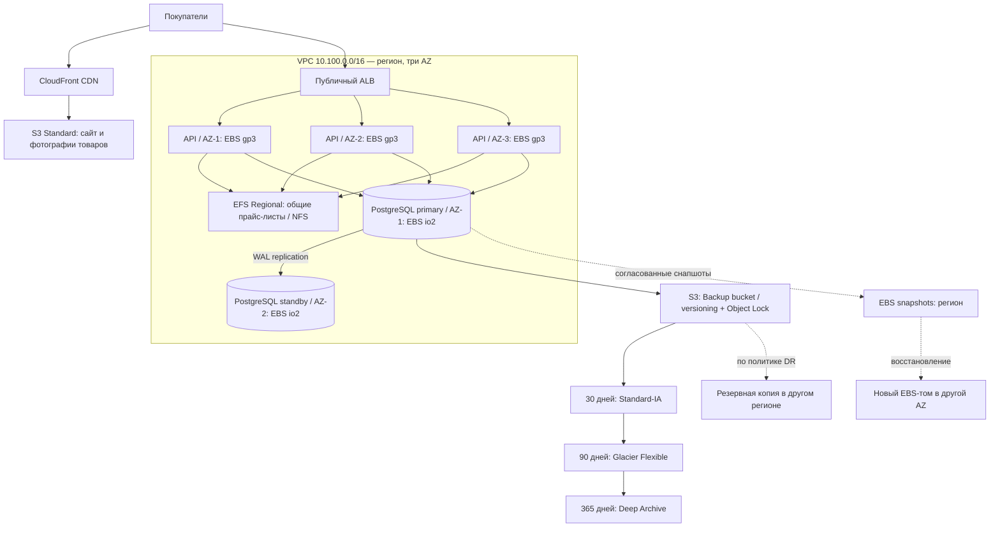

# Лабораторная работа № 5 — Хранилища данных в облаке

**Проект:** интернет-магазин фруктов и ягод «Пальчики оближешь»  
**Тема:** Block, File, Object — выбор и применение  
**Формат:** проектирование целевой облачной архитектуры

## 1. Исходные данные и связь с предыдущими лабораторными

Магазин обслуживает покупателей Ленинградской области. Основные сценарии: просмотр каталога с фотографиями, оформление заказа, обновление остатков, отслеживание доставки. В лабораторных № 1 и № 3 спроектирована VPC `10.100.0.0/16` с тремя зонами доступности и подсетями public/private/data.

Задача этой работы — **спроектировать**, какие облачные хранилища потребуются тем же данным при размещении в AWS. Описанные EBS, EFS, S3 и CloudFront — целевая модель, а не утверждение об их фактическом развёртывании. MinIO остаётся элементом существующего учебного стенда.

## 2. Сравнение Block / File / Object

| Критерий | EBS — Block | EFS — File | S3 — Object |
|---|---|---|---|
| Уровень абстракции | Блоки диска | Файлы и каталоги | Объекты с ключами и метаданными |
| Единица данных | Блок | Файл | Объект |
| Доступ | Блочное устройство EC2; файловую систему создаёт ОС | NFSv4.1, общий POSIX-каталог | HTTPS, S3 API |
| Клиенты | Обычно одна EC2 для обычной файловой системы; есть специальные режимы Multi-Attach | Многие EC2 одновременно | Много независимых клиентов через API |
| Производительность | Низкая задержка и настраиваемые IOPS | Удобный общий доступ, сетевая задержка | Высокая масштабируемость, но не POSIX-диск для транзакционной БД |
| Масштаб | Управление размером и классом тома | Эластичная файловая система | Объектное масштабирование без управления томами |
| Стоимость | Плата за выделенные характеристики тома | За использование и выбранную производительность/класс; не обязательно дешевле EBS | Зависит от класса, запросов, получения и передачи данных |
| Устойчивость | Том привязан к AZ; снапшоты региональные | Выбираем Regional EFS с несколькими AZ | S3 Standard хранит данные избыточно между несколькими AZ региона |

**Вывод:** Block подходит для дисков ОС и транзакционных баз, File — для одновременного доступа нескольких серверов к дереву файлов, Object — для масштабируемой статики и архивов. Нельзя утверждать, что стоимость и задержки всегда монотонно уменьшаются от Block к Object: тарифы и операции различаются. При этом экономичность долговременных архивов у холодных классов S3 обычно выше, чем у постоянно выделенных SSD-томов.

## 3. Назначение хранилищ компонентам магазина

| Компонент / данные | Тип | AWS / класс | Причина |
|---|---|---|---|
| Фронтенд: HTML, JS, CSS | Object | S3 Standard + CloudFront | Высокая доступность и кэширование статики ближе к покупателям |
| Фото фруктов, ягод и карточек товаров | Object | S3 Standard + CloudFront | Много файлов, нерегулярные чтения, доступ по HTTPS |
| Виртуальные машины API, логистики и платежей | Block | EBS gp3 | SSD для ОС, зависимостей и временных локальных файлов без переплаты за io2 |
| PostgreSQL: заказы, пользователи, остатки, транзакции | Block | EBS io2 для primary и standby в разных AZ | Предсказуемая производительность I/O, поддержка снапшотов; IO-профиль требует фактической проверки перед производственной закупкой |
| Общие шаблоны товарных прайс-листов и выгрузок между несколькими API-серверами | File | EFS Regional, General Purpose, NFS | Одновременное чтение/запись через общий путь; EFS не заменяет БД |
| Бэкапы PostgreSQL, экспорт заказов, архивные отчёты | Object | S3 Standard → Standard-IA → Glacier Flexible Retrieval → Deep Archive | Долгий срок хранения, жизненный цикл, версионирование |
| Существующее учебное хранилище изображений/бэкапов | Object | MinIO (S3-совместимое, не AWS S3) | Сохраняется на текущем Docker-стенде; для HA потребуются отдельные узлы/диски и резервные копии |

Для БД выбираем **io2** как целевой вариант под предсказуемые IOPS, потому что она обрабатывает финансово значимые операции и заказы. В небольшом магазине **gp3** может оказаться экономически достаточным: окончательный выбор в production должен опираться на фактические IOPS, throughput, latency и стоимость. **io1** — более ранний класс provisioned IOPS; **st1/sc1** (HDD) не подходят для транзакционного PostgreSQL с произвольным I/O. Для ОС достаточно gp3.

## 4. Аналоги облачных сервисов

| Тип | AWS | Yandex Cloud | VK Cloud | Azure | Google Cloud |
|---|---|---|---|---|---|
| Block | EBS | Compute Cloud — сетевые диски | Cloud Block Storage / Volumes | Managed Disks | Persistent Disk / Hyperdisk |
| File | EFS | Cloud File Storage | Cloud File Storage (NFS) | Azure Files | Filestore |
| Object | S3 | Object Storage | Cloud Storage (S3 API) | Blob Storage | Cloud Storage |

Названия и функциональные возможности сервисов различаются; таблица показывает функциональные аналоги, а не идентичность SLA и тарифов.

## 5. Классы S3 и жизненный цикл

| Класс | Когда используем | Скорость доступа | Особенность стоимости |
|---|---|---|---|
| Standard | Актуальные фото, свежие резервные копии | Онлайн, миллисекунды | Дороже холодных классов за ГБ, без платы за извлечение Standard |
| Intelligent-Tiering | Объекты с непредсказуемой частотой обращения | Частые уровни онлайн; архивные уровни могут требовать восстановления | Автоматизация переходов, возможна плата за мониторинг |
| Standard-IA | Редко используемые, но быстро нужные копии | Онлайн, миллисекунды | Ниже хранение, плата за извлечение; минимальный срок хранения |
| Glacier Flexible Retrieval | Архив заказов и бэкапов | Восстановление от минут до часов в зависимости от режима | Дешевле хранение, платные операции и минимальные сроки |
| Glacier Deep Archive | Длительный архив старых копий | Восстановление обычно в течение часов | Очень низкая цена хранения, длительный минимальный срок и задержка восстановления |

**Правило для бакета `palchiki-db-backups` (проектируемое):**

1. Новые резервные копии → S3 Standard. Быстрое восстановление после свежего сбоя.
2. На 30-й день → Standard-IA. Копии реже востребованы, но доступны немедленно.
3. На 90-й день → Glacier Flexible Retrieval. Устаревшие бэкапы требуются только для расследований и восстановления.
4. На 365-й день → Glacier Deep Archive для копий с обязательным длительным сроком хранения; срок и состав архива определяются политикой хранения и требованиями к персональным данным.
5. По истечении утверждённого срока — удаление по отдельному правилу, кроме объектов с действующей блокировкой хранения.

Такое правило экономит на ежемесячном хранении редко запрашиваемых объектов, но выгодность зависит от количества запросов, расходов на переходы и восстановления, а также минимальных сроков хранения классов. Для короткоживущих маленьких объектов переход может быть невыгоден. Правила должны учитывать **версии** объектов отдельно: непреднамеренно оставленные старые версии тоже оплачиваются.

Для бэкапов включаем **S3 Versioning**, **Block Public Access**, шифрование, доступ сервисной роли по минимальным правам и **Object Lock** в режиме Governance/Compliance по выбранной политике для защиты от удаления и шифровальщика. Versioning позволяет восстановить предыдущую версию после ошибочной перезаписи, но само по себе не защищает от администратора с правами удаления всех версий. Для защиты от региональной катастрофы рассматриваем репликацию критичных резервных копий в другой регион: хранение в нескольких AZ одного региона не равно межрегиональному DR.

### S3 Select и Glacier Select

Исторически S3 Select позволял выполнять ограниченные SQL-подобные запросы непосредственно к содержимому поддерживаемых объектов, чтобы извлекать только нужные строки/столбцы. Glacier Select выполнял похожую задачу для архивных данных. **Это справочный пункт задания, а не рекомендуемое решение для нового проекта:** S3 Select закрыт для новых клиентов AWS; доступность Glacier Select также необходимо проверять отдельно. Для нового сервиса следует использовать Athena, S3 + аналитическую обработку либо восстановление объектов перед анализом.

## 6. Снапшоты, репликация и восстановление

- **EBS:** том живёт внутри конкретной AZ, региональный снапшот позволяет создать *новый* том в другой AZ того же региона. Для согласованной копии PostgreSQL необходима координация с СУБД (например, backup/WAL), а не только снимок произвольного тома во время записи. Снапшоты по расписанию, периодические пробные восстановления; для регионального DR — копирование в другой регион.
- **PostgreSQL:** primary и standby размещаем в разных AZ, данные реплицируются потоком WAL. Репликация не заменяет бэкап: случайное удаление или ошибочный SQL запрос тоже могут реплицироваться. Для восстановления на момент времени нужны базовые бэкапы и WAL-архив.
- **EFS:** выбираем Regional EFS, создаём mount targets в трёх AZ; серверы подключаются через NFSv4.1 с TLS и разрешёнными security groups. Региональный тип обеспечивает избыточность данных между AZ.
- **S3 Standard:** данные рассчитаны на избыточное хранение в нескольких AZ одного региона; CloudFront кэширует статику. Versioning и (при необходимости) cross-region replication решают другие задачи: восстановление после удаления и региональных аварий.
- **MinIO:** существующее развёртывание на одном домашнем сервере нельзя считать отказоустойчивым эквивалентом S3 Regional. Его данные требуется резервировать отдельно.

## 7. Архитектура хранения

**Сетевая изоляция:** ALB — в публичных подсетях; API — в private; PostgreSQL — в data. Подключение к EFS по TCP 2049 разрешено только нужным группам API. Доступ к S3 — через VPC Endpoint и IAM, публичный доступ к бакету бэкапов запрещён. Фотографии каталога доступны через CloudFront; origin S3 защищается Origin Access Control. PostgreSQL доступен только прикладным сервисам по TCP 5432.

## 8. Чек-лист выбора хранилища — шесть вопросов

| Вопрос | Решение для магазина |
|---|---|
| 1. Нужен ли интерфейс диска/произвольная запись блоков? | Да — ОС API и PostgreSQL → EBS |
| 2. Нужна ли файловая структура и POSIX-семантика? | Да — общий каталог прайс-листов → EFS |
| 3. Нужен ли одновременный доступ нескольких инстансов? | Да — EFS Regional по NFS; не один обычный EBS-диск |
| 4. Насколько чувствителен сервис к IOPS и задержке? | PostgreSQL → io2; системные диски API → gp3; статика → S3 |
| 5. Каков объём и частота доступа? | Частые изображения → S3 Standard; редкие бэкапы → IA/Glacier |
| 6. Какие RPO/RTO, долговечность и бюджет? | WAL + бэкапы PostgreSQL; EFS Regional; S3 versioning и Lifecycle; тесты восстановления |

## 9. Контрольные вопросы

**1. Кто создаёт файловую систему поверх блочного диска?** ОС (или администратор средствами ОС); примеры: ext4, XFS, NTFS. EBS выдаёт блочное устройство, а не общую файловую шару.

**2. Почему нельзя просто подключить один блочный диск к нескольким ВМ?** Обычная файловая система ext4/XFS не координирует конкурентную запись несколькими независимыми ОС, поэтому возможна порча данных. Специальный EBS Multi-Attach существует для поддерживаемых типов/условий, но требует кластерной ФС и приложения с координацией. EFS уже реализует общий файловый протокол.

**3. Где хранится EBS snapshot?** В региональной инфраструктуре сервиса снапшотов, не в исходной AZ. Снимок позволяет создать том в другой AZ того же региона.

**4. Классы от горячего к холодному:** Standard → Intelligent-Tiering (динамический класс) → Standard-IA → Glacier Flexible Retrieval → Glacier Deep Archive. Это учебная последовательность; Intelligent-Tiering не фиксированный уровень «холодности».

**5. Зачем S3 Select / Glacier Select?** Исторически позволяли обрабатывать подмножество данных на стороне хранилища, уменьшая передаваемый объём. Для новых систем следует учитывать ограничения доступности этих функций и использовать актуальные альтернативы.

**6. Аналоги EBS/EFS/S3 у Yandex Cloud и VK Cloud:** сетевые диски / файловое хранилище / объектное хранилище (подробнее — таблица раздела 4).

**7. Правило выбора одной фразой:** блоки для транзакций и ОС, файлы для общего каталога, объекты для статики и архивов.

## 10. Выводы

Для магазина «Пальчики оближешь» спроектирована комбинированная модель хранения: EBS gp3 для виртуальных машин, EBS io2 для транзакционного PostgreSQL, Regional EFS для разделяемых файлов, S3 + CloudFront для сайта и изображений, S3 с Lifecycle для архива. Схема учитывает три AZ и продолжает логику репликации из Лабы 6. Разграничены понятия репликации, снапшотов, резервных копий и защиты от удаления; задана политика снижения стоимости по мере старения данных.

**Границы выполнения:** расчёт реальной стоимости, нагрузочные замеры IOPS и запуск AWS-ресурсов в этой лабораторной не проводились; приведённые решения являются проектными и требуют проверки на реальной нагрузке перед внедрением.

## Источники

- [Официальное условие Лабы 5](https://github.com/KeladKaal/cloud-infrastructure/blob/main-rus/lecture-5-cloud-storage/lab.md)
- [AWS: EBS volume types](https://docs.aws.amazon.com/ebs/latest/userguide/ebs-volume-types.html)
- [AWS: S3 storage classes](https://docs.aws.amazon.com/AmazonS3/latest/userguide/storage-class-intro.html)
- [AWS: EFS Regional storage](https://docs.aws.amazon.com/efs/latest/ug/storage-classes.html)
